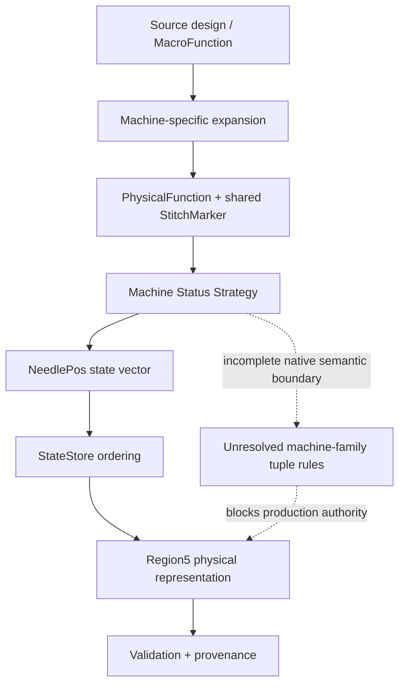

# EmbroideryAI

[](https://github.com/asadabumba/EmbroideryAI-Research/actions/workflows/ci.yml)

EmbroideryAI is a research-grade Python project exploring native embroidery design formats, machine-state semantics, deterministic Region5 reconstruction, and evidence-driven reverse engineering. The public snapshot focuses on reproducible offline tooling and verified findings; it is not a finished commercial product, a production serializer, or a distribution of proprietary software.

> **Research boundary:** `NATIVE_SEMANTICS_PROVEN = false` and `PRODUCTION_AUTHORITY = false`.

## At a glance

**Long-term goal.** Build an intelligent workflow that can help turn artwork into machine-embroidery designs. The ongoing research is evaluating two possible integration paths: offline generation/editing of native design files, or automation of the embroidery application's user interface when direct file creation is not feasible.

**What works in this public release:**

- A deterministic Python codec for the verified *physical* Region5 record format, with input validation and exact round trips for supported records.
- A standalone Tajima DST reader and synthetic stitch-command examples.
- Synthetic models of StateStore ordering and narrowly scoped machine-family translation rules.
- Evidence/provenance utilities, 29 unit tests, and an automated CI workflow.

**Not yet delivered:** an image-to-embroidery ML model, native `.emb` semantic generation, a production-grade writer, or a working Wilcom GUI agent. The public repository intentionally excludes proprietary runtime materials and private evidence. Research claims are scoped in [Research status](docs/research-status.md).

**Quick start** (Python 3.11+):

```bash
python -m pip install -e ".[dev]"
python -m pytest -q
python -m ruff check .
python examples/region5_roundtrip.py
```

## What this project demonstrates

- Python engineering for deterministic binary codecs and parsers
- binary-format analysis and malformed-input handling
- x64 reverse engineering and ABI reconstruction
- control-flow graph analysis and runtime-function boundary validation
- vtable and RTTI recovery
- indirect-call and import/IAT resolution
- machine-specific semantic reconstruction
- provenance-aware analysis and fail-closed evidence handling
- adversarial verification and counterexample-driven research
- automated unit tests built from synthetic, redistributable fixtures
- research tooling designed to separate physical encoding from native semantics

## Research highlights

1. **Region5 physical grammar — PROVEN.** Each record is a canonical ULEB32 encoding of a signed int32's uint32 representation, followed by two raw bytes. One-, two-, three-, and five-byte first-field spellings are covered by synthetic tests.
2. **Region5 writer structure — PROVEN at the structural level.** Static analysis recovered the record-emission shape and the separation between source records and physical encoding. This does not prove semantic tuple production.
3. **e4.2 StateStore insertion/storage order — PROVEN within `PutStateSetting`.** The recovered lower-bound key is the native `NeedlePos` order followed by state ID; value is not part of the key. A new exact-key duplicate is inserted before older equivalents. Separately, the archived e1.5 writer is proven to serialize a `StateSettingIter` in its existing storage order. This audit does not assume that the e1.5 writer implementation proves the e4.2 writer path.
4. **Machine-status strategy reconstruction — PARTIAL by family.** Dispatch, status-object, and transition paths have been reconstructed in several areas, but the public evidence does not justify a project-wide closed-strategy count.
5. **PhysicalFunction / StitchMarker ownership — PROVEN.** PhysicalFunctions retain shared markers selected by `NeedlePos`, and MacroFunction ownership/list linkage is distinct from FunctionStore insertion order.
6. **Source-level PF17 reconstruction — PROVEN in a narrow machine-specific domain.** The proven native producer belongs to `SchiffliMachine`:

   ```text
   MacroFunction.FunctionTag.byte1 == 0xA5
     -> primary selector 0x17
     -> secondary selector 0x18
     -> MacroExpansionRequest tag 0x1700
     -> PhysicalMachine::AddComponent
     -> PhysicalFunction.FunctionTag.byte1 == 0x17
   ```

   The rule is **machine-family-specific**. An adversarial `ZTCMachine` counterexample maps source `0xA5` to primary `0x06` and secondary `0x07`. Therefore, `0xA5` does not universally mean PF17. Separate `BarudanZMachine` evidence proves a downstream PF17-consuming status path and configured borer-needle field; it does not reattribute the PF17 source rule to Barudan Z.
7. **Provenance hardening — VERIFIED methodology.** Claims are bound to evidence class and scope; target-derived controls are not promoted to native semantics, and instrumentation failures remain inconclusive.
8. **Regression tests — INCLUDED.** Public tests cover canonical ULEB encoding, signed values, malformed inputs, raw-byte order, duplicate ordering, provenance classification, machine-family counterexamples, and synthetic DST state transitions.

## Current research status

| Area | Status |
|---|---|
| Region5 physical grammar | **PROVEN** |
| Region5 writer structure | **PROVEN** structurally; semantic tuple production remains open |
| e4.2 StateStore insertion/storage order | **PROVEN** within `PutStateSetting` |
| e1.5 writer traversal of StateStore | **PROVEN** to follow existing iterator/storage order |
| e4.2 writer traversal of StateStore | **NOT PROVEN** by the preserved evidence used in this audit |
| Direct machine-state strategies | **PARTIAL**; no publishable `CLOSED` count is established by the current checkpoint |
| Pocket table-driven strategy | **INCONCLUSIVE** in the current publishable evidence; not promoted to `CLOSED` |
| Barudan / Tajima / Toyota / related family strategies | **PARTIAL** |
| PF17 source rule | **PROVEN** for the narrow Schiffli/e4.2 producer path; Barudan Z is a separate downstream consumer |
| Full native Region5 semantic regeneration | **NOT PROVEN** |
| Production writer | **DISABLED** |

The conservative statuses above are intentional. The private research tree contains broader experiments, but this snapshot publishes only claims supported by the current verified checkpoint.

## Architecture



See [Architecture](docs/architecture.md) for the detailed boundary model.

## Methodology

The research combines static xref enumeration, `.pdata`/runtime-function validation, Windows x64 ABI reconstruction, vtable/RTTI identification, import/IAT resolution, backward slicing, dataflow reconstruction, source-vs-target separation, provenance classification, adversarial falsification, and synthetic/offline regression tests.

The complete approach is documented in [Methodology](docs/methodology.md).

## Evidence model

- **PROVEN** — supported by direct, scoped evidence and adversarial checks.
- **STRONGLY SUPPORTED** — multiple consistent observations, but an independent link or boundary remains unresolved.
- **PARTIAL** — bounded subclaims are established, while the complete behavior remains unresolved.
- **HYPOTHESIS** — falsifiable model awaiting sufficient evidence.
- **NOT PROVEN** — available evidence does not establish the stated claim.
- **INCONCLUSIVE** — evidence cannot support a semantic conclusion.

A matching target is not enough if target-derived data influenced the result. Claims are not promoted without independent evidence and explicit scope.

## Reproducibility

The public snapshot is fully offline and uses synthetic fixtures only.

```bash
python -m venv .venv
# Windows: .venv\Scripts\activate
# POSIX:   source .venv/bin/activate
python -m pip install -e ".[dev]"
python -m pytest -q
python -m ruff check .
python examples/region5_roundtrip.py
```

Private binary analysis, runtime instrumentation, and proprietary application integration are **research-only / not included in the public repository**.

## Testing

```bash
python -m pytest -q
```

The tests require no proprietary DLLs, executable, installed embroidery software, live process, or private capture.

## Repository structure

```text
.
├── src/embroideryai/          # Public offline codecs and research models
├── tests/                     # Deterministic synthetic unit tests
├── tests/fixtures/            # Synthetic provenance fixtures
├── examples/                  # Reproducible offline examples
├── docs/                      # Architecture, methods, status, and sanitized findings
└── .github/workflows/ci.yml   # Minimal-permission test and lint workflow
```

## Limitations

- Full native Region5 semantic regeneration is incomplete.
- Machine behavior is family-specific; mappings must not be generalized without evidence.
- Some advanced analysis depends on proprietary runtime software and private evidence that is not distributed.
- No production writer is authorized or enabled.
- Compatibility with future proprietary software versions is not guaranteed.
- The public models demonstrate verified boundaries; they do not replace native application behavior.

## Legal / third-party notice

Third-party software, trademarks, proprietary binaries, proprietary source code, raw memory captures, and customer files are not distributed by this repository. The repository contains independent research tooling, synthetic fixtures, and documentation. See [THIRD_PARTY.md](THIRD_PARTY.md).

## Roadmap

- Close remaining machine-family strategy branches with independently sourced evidence.
- Expand synthetic fixtures for malformed records, duplicate keys, and state transitions.
- Improve source-level tuple-production reconstruction without target leakage.
- Strengthen CI and reproducible package validation.
- Add more offline examples and format visualizations.
- Extend provenance tooling and machine-readable evidence manifests.
- Investigate the remaining boundary between StateStore entries and semantic Region5 tuples.

## Documentation

- [Architecture](docs/architecture.md)
- [Methodology](docs/methodology.md)
- [Research status](docs/research-status.md)
- [PF17 source rule](docs/reverse_engineering/pf17-source-rule.md)
- [Region5 physical format](docs/region5/format.md)
- [Region5 ordering](docs/region5/ordering.md)
- [Region5 semantic status](docs/region5/status.md)
- [Portfolio perspective](docs/portfolio.md)
- [Publication audit](docs/publication-audit.md)
- [Final public release evidence audit](docs/final-public-release-audit.md)

## Contact

Use the GitHub profile or repository issues. No public email address is embedded in this snapshot.

## License

Licensed under the [MIT License](LICENSE).
