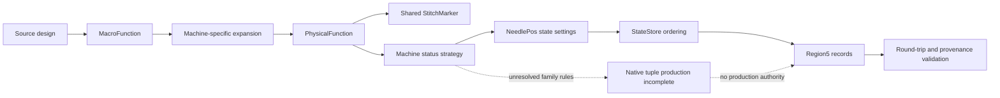

# Architecture

## System boundary

EmbroideryAI separates three layers that are easy to conflate:

1. **Source semantics** — MacroFunctions, machine-family dispatch, PhysicalFunctions, StitchMarkers, and machine status.
2. **State organization** — NeedlePos-indexed state settings, e4.2 insertion/storage ordering, and separately scoped e1.5 writer traversal.
3. **Physical representation** — canonical ULEB32 plus two raw bytes per Region5 record.

Only the third layer is fully implemented as a public codec. Selected relationships in the first two layers are documented or represented as bounded synthetic models.

## Public modules

- `region5.py` implements the proven physical grammar and rejects noncanonical or ambiguous encodings.
- `state_store.py` models the proven e4.2 `PutStateSetting` insertion/storage key and newest-first exact-key duplicate behavior using synthetic inputs; it is not a native writer implementation.
- `machine_rules.py` exposes only the bounded Schiffli and ZTC `0xA5` mappings, demonstrating why source tags are machine-specific.
- `evidence.py` provides the public evidence vocabulary and scoped-claim validation.
- `dst.py` is an offline parser for a documented embroidery command format, included to show reusable binary parsing outside private evidence.

## Trust boundary

The public repository contains no proprietary binaries, raw runtime captures, target-derived lookup tables, customer designs, or production writer. Private runtime evidence may support the documentation, but the public code must remain useful and testable without it.

## Production boundary

`NATIVE_SEMANTICS_PROVEN = false` and `PRODUCTION_AUTHORITY = false`. A physical byte-for-byte round trip is evidence about encoding, not proof that native semantic values can be regenerated from arbitrary source designs.
